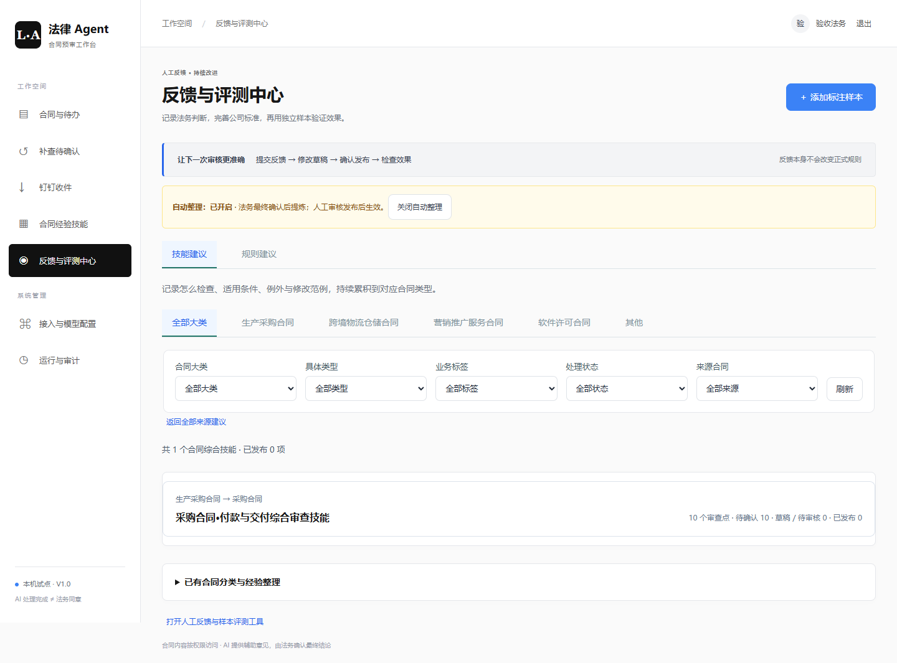
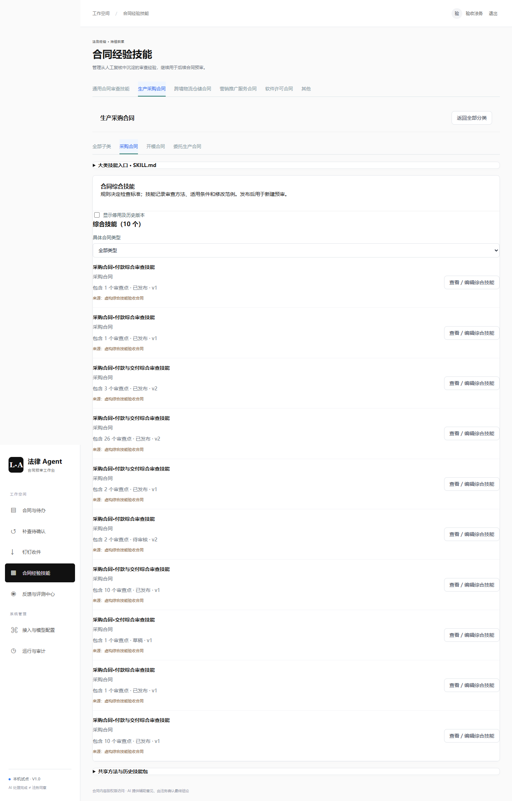

# 一份合同一个综合技能

已于 2026-11-05 上线，正式版本 `20261105-contract-skills-053111`；备份、业务数据保护和公网页面结果见[上线验收](综合技能上线验收-20261105.md)。

## 使用方式

“反馈与评测 → 技能建议”按合同聚合；同一合同不同确认稿的经验位于同一个折叠入口，内部显示各审查点、适用条件、例外、范例、证据及处理状态。分类和状态筛选仍可用，分页单位改为合同，筛选命中后保留该合同的完整任务及关联规则，避免只采纳一页中的部分审查点。

核对内部内容后，点击“统一采纳为综合技能草稿”。有依赖时先采纳、审核并发布关联规则。排除审查点须记录理由；同一合同有未发布综合技能时先处理已有草稿，重复采纳同一来源返回已有草稿。

“合同经验技能”按合同大类、具体类型展示。每份合同只显示一个综合技能入口，优先展示待处理的新版本；展开历史选项可查看全部版本。技能名称概括审查主题，并显示有权限访问的来源合同名称。同一合同后续确认形成原技能的新版本，累积保留已有审查点；完整覆盖时不重复生成。

综合技能统一编辑、提交审核与发布。修改现有审查点保留编号和原始证据；删除须明确指定并记录理由。正式内容变化只影响后续新建预审。

大类入口可以编辑适用描述、审查流程与输出要求，沿用草稿、审核、发布流程。没有自定义入口时使用系统原有审查要求形成的标准入口，不新增法律标准。

## 文件与运行

发布前生成并验证标准目录：`SKILL.md` 包含 YAML `name`、`description`、审查流程及引用；`references/<typeId>/<versionId>.md` 保存一份合同综合技能，内部按审查点分节。预览和 ZIP 导出不包含原始证据、人工处理理由或联系方式。

文件写入 `DATA_ROOT/skills/<整体SHA-256>/`，先写临时目录，再原子重命名。清单记录生成器版本、入口版本、逐文件 SHA-256 和审查点段落范围；采用稳定键序计算哈希，数据库 JSONB 键顺序变化不影响校验。发布事务失败时原正式版本保持生效。

新建预审固定技能内容和文件清单。分类后读取通用入口、所属大类入口及命中的引用段落；逐项过滤标签和规则依赖，超过批次限制时完整分批读取。网关使用实际文件正文，旧快照无文件信息时沿用原内容。文件缺失或哈希不匹配明确报错，不回退到当前数据库正文。

生成器 v2 将通用入口和所属大类入口同时固定在 `SKILL.md`，清单分别记录两个入口的版本；v1 历史文件仍按原清单校验读取。经验库为空、当前类型没有综合技能或所有审查点被条件排除时，仍读取适用入口文件。入口作为运行上下文保存在任务快照，不新增合同技能卡片；审查计划的 `skillPacks` 与 `skillEntries` 分别返回技能和独立入口。

普通预审、联合审查和评测通过同一网关加载文件。详情、报告快照及覆盖记录包含文件哈希。后续入口或方法发布不会改变排队任务和重试使用的文件。

## 存储与兼容

- 迁移 `015_contract_skill_bundles.js` 在现有技能版本表增加来源合同、文件清单和旧方法替代关联；新建大类入口版本表。合同技能稳定编号为 `review-contract-<contractId>`，来源合同有且只有一个待处理版本。
- 原规则与技能接口保留。新增 `POST /contracts/:id/skill-draft`、大类入口版本接口及技能文件预览、ZIP 导出接口；完整参数见 OpenAPI。
- `GET /learning-proposals?kind=skill&groupBy=contract` 返回按合同分页的 `items[].tasks`；旧调用仍按审查点分页。计数区分合同数量和匹配审查点数量。
- 旧提案和原技能版本保留。整理旧内容时记录原草稿关联；新综合技能发布后，新任务只排除来源完全属于本合同且内容签名吻合的旧方法。多合同共享方法继续生效，历史预审快照保持原样。
- 合同分类整理迁移整个综合技能，保留合同身份、版本父节点和旧文件。存在未处理草稿时提示先核对，防止跨分类覆盖。
- 技能列表和文件不返回原始证据；来源详情继续按合同权限读取。新接口沿用会话、CSRF、角色权限、修订号及操作审计。

## 验证与上线

新增集成测试 `backend/test/integration/contract-skills.test.js` 覆盖十审查点聚合、幂等、同合同更新、累积保留、无新增经验、排除理由、规则依赖、并发基线、文件生成失败、篡改检测、实际模型输入、分批加载、预审与评测快照、入口发布、旧内容整理、共享方法保留、分类迁移及桌面/手机操作闭环。浏览器和模型 HTTP 使用真实页面与确定性适配器，不向外部模型发送合同。

```powershell
npm run build
npm test
node --test --test-concurrency=1 backend/test/integration/contract-skills.test.js backend/test/integration/skills-learning.test.js backend/test/integration/learning-catalog.test.js backend/test/integration/offline-learning.test.js backend/test/integration/joint-intakes.test.js
```

浏览器验收时设置 `CONTRACT_SKILL_BROWSER=1`，并让 `NODE_PATH` 指向包含 Playwright 的运行时；测试创建独立数据库并在结束后销毁，文件与截图保存在隔离测试目录。

2026-11-05 本地回归通过：106 项单元测试，78 项集成测试。其中经验沉淀联动 42 项、综合技能专项 13 项，已启用真实页面的桌面及 390 像素手机验收；另 36 项覆盖普通预审、软件合同与预分析。45 份生成的 `SKILL.md` 通过 `skill-creator` 标准校验，前端生产构建和 OpenAPI 引用检查通过。文件生成失败测试主动制造磁盘错误，验证旧正式版本持续生效；真实 PostgreSQL 备份恢复验证技能文件及历史任务清单完整。模型 HTTP 使用确定性适配器；正式部署结果见上方上线验收，不作为真实合同质量评测。





手机页面截图见[390 像素展示](screenshots/综合技能-手机展示.png)。

部署前备份数据库及文件，执行 `npm run db:migrate` 至迁移 015，再重启 API 与 Worker。备份和恢复同时包含 `objects/` 与 `skills/`。不批量发布旧提案，不改写已确认合同或历史结论。回退应用时保留新表、列和技能目录；迁移 down 明确拒绝删除业务历史。
