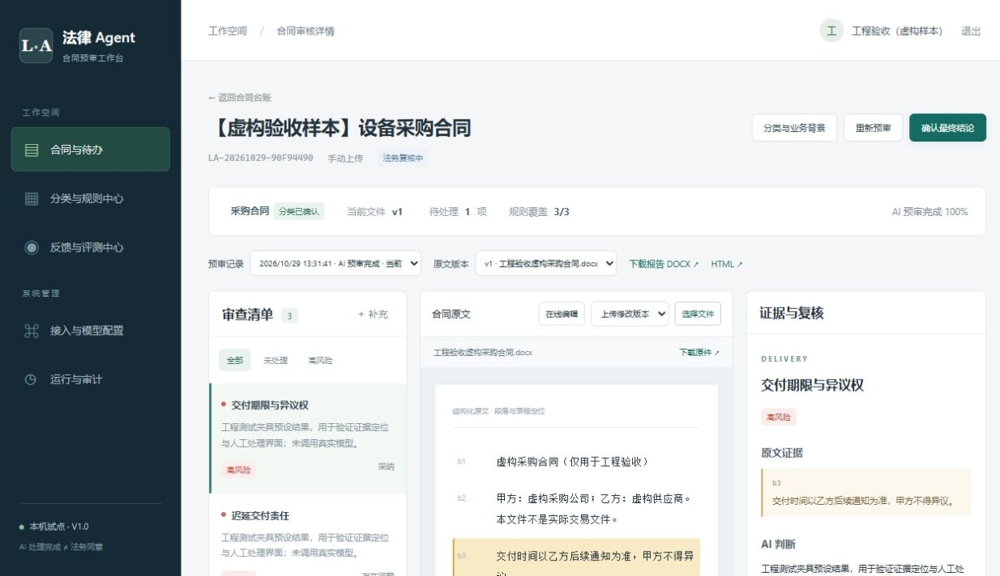
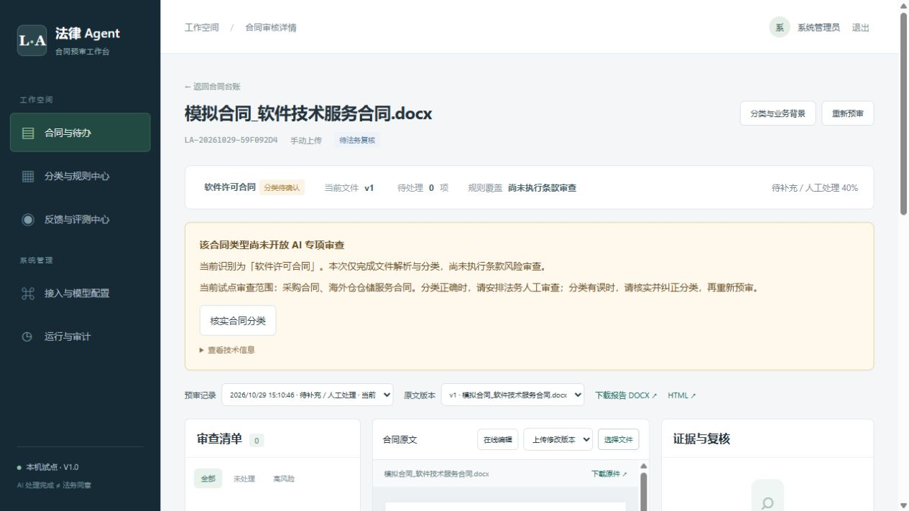
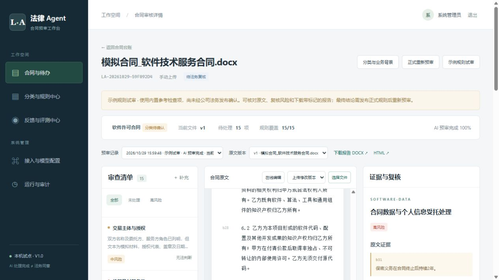
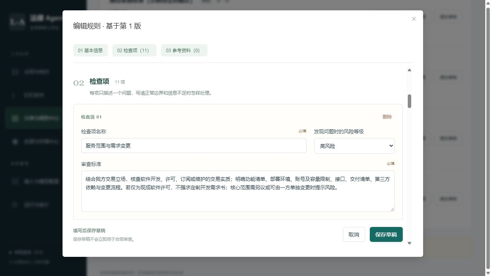
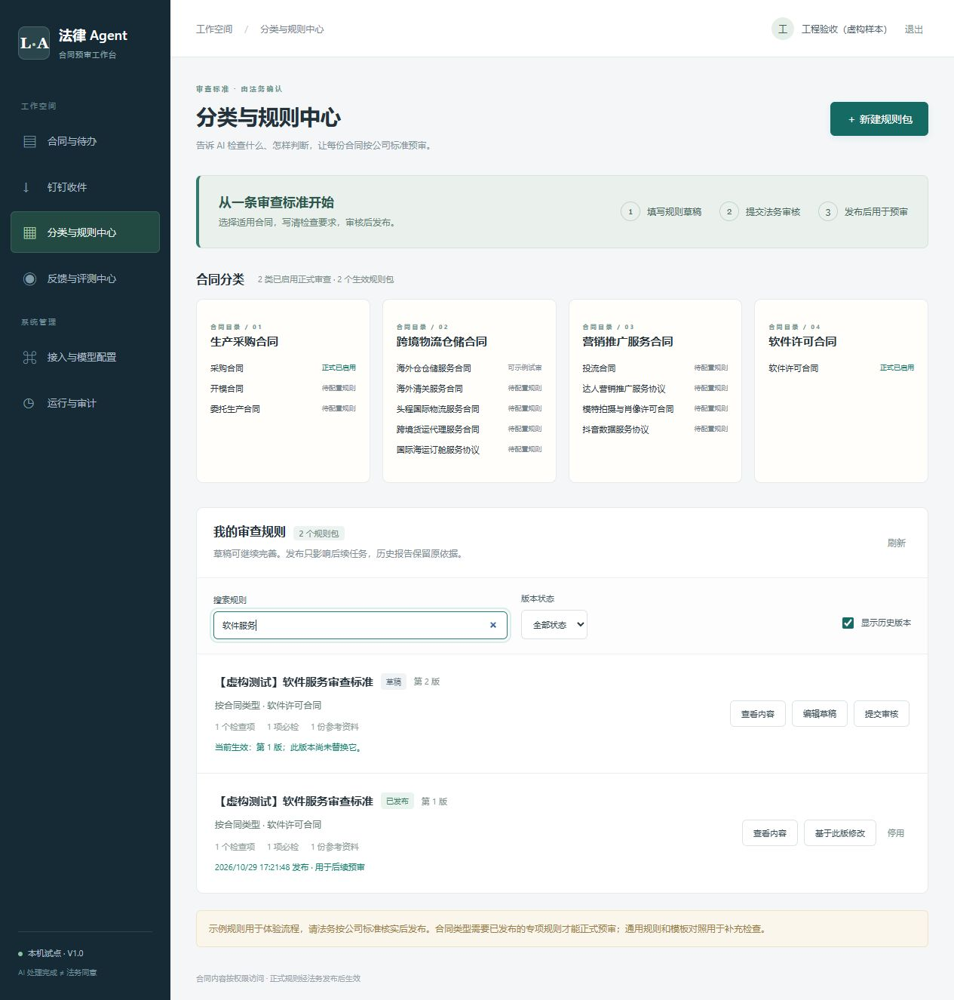

# 工程验证记录

日期：2026-10-29。环境：Windows、Node.js 24.21.0、原生 PostgreSQL 18.4 开发运行时。仅使用虚构合同和明确的工程夹具；未向外部模型发送真实合同。

## 已执行

| 检查 | 结果 | 证据及边界 |
|---|---|---|
| `npm test` | 8 项通过 | DOCX 段落/表格、混合 PDF 分流、长文完整分块、引用与必检覆盖、429/三次请求、分块风险聚合、无正例不可评估、长 Retry-After 与报告来源/人工意见 |
| `npm run test:integration` | 14 项通过 | 使用随机独立测试库，真实 SQL、会话、文件、队列及备份工具 |
| `npm run build` | 通过 | Vue/Vite 生产构建；按页面与 PDF 模块分包 |
| `npm audit --omit=dev` | 0 个已知漏洞 | npm 当次依赖库查询结果，不代表所有部署组件均无风险 |
| OCR Python 语法编译 | 通过 | 尚未加载 PaddleOCR 模型执行实际扫描识别 |
| 数据恢复演练 | 通过 | 实际 pg_dump、独立空库 pg_restore、原件哈希、清理恢复会话；默认开发库也执行过独立恢复演练 |
| OpenAPI 生成 | 通过 | 46 个操作，保留 `/api` 前缀 |
| Compose YAML 结构解析 | 通过 | 静态解析服务与配置；不代表 Docker Compose 或镜像可实际运行 |

14 项 PostgreSQL 集成测试覆盖：

1. 登录、CSRF、Origin 及管理员不自动具备法务权限。
2. 不可变上传、Outbox、匿名和跨用户下载拦截、伪造用户 ID、限时文件凭证范围。
3. 无正式规则进入待处理，不生成完整报告。
4. Socket.IO 无会话连接被拒，越权合同订阅失败。
5. 发布规则后执行预审，技术完成不自动形成法务结论。
6. 分类、未处理项、理由、并发记录版本及附条件结论限制；不确定项必须有法务意见；业务可读退回理由；DOCX/PDF 报告导出。
7. 同内容去重、内容变化新版本、旧结论不能覆盖新文件。
8. 新规则发布不改变历史快照。
9. 伪造 OnlyOffice 回调、非配置来源下载地址被拒。
10. 模拟钉钉事件和附件重复幂等、附件内容变化形成新版本。
11. 编辑器 A/B/A 保存回放不会生成或恢复旧版本。
12. 负责人分配、分页筛选仍服从合同权限；补充材料/签署件不改变主合同；签署归档关联。
13. pg-boss 重启及发送后未记账情形下保持 Outbox 幂等。
14. 真实备份恢复独立数据库及不可变文件校验。

## 界面验证

真实开发入口为 `http://localhost:8080`，当前账号已通过迁移统一为管理员，具备法务、规则发布和管理权限。登录、空台账和配置缺失检查仍适用。

`scripts/ui-qa.js --allow-test-fixture` 建立另一个随机数据库、随机账号及 3001 端口服务器，页面和合同均明确标记为虚构工程样本。夹具提供三条固定结果以检查风险列表、原文高亮、复核表单和分类操作；这些结果不证明模型能够识别对应法律风险。该入口不会被产品默认启动。

浏览器中完成分类及立场确认、原文定位和复核保存，待处理项由 2 降为 1，法务状态更新为复核中。已修正原文定位滚动影响整个页面的问题，定位只滚动原文容器。

## 未完成的业务及部署验收

- Docker / WSL2、容器镜像实际启动、Linux 字体与完整服务运行。
- 真实 PaddleOCR、OnlyOffice 编辑器、Milvus / Embedding 链路。
- 指定外部模型及 Jev 的真实调用、耗时、费用、分类和风险质量。
- 钉钉租户权限、审批模板、法务节点、附件字段及断网补偿联调。
- 两类各不少于 20 份法务标注合同、独立验收集、公司正式规则及模板。
- 强杀运行中的 Worker 后恢复、整机断电、固定电脑性能和日常运维演练。

上述事项未通过前，不宣告 M0–M4 全部验收或达到模型质量指标。

## 配置模块增量验证

配置页重构后，8 项单元测试、21 项集成测试及生产构建通过，OpenAPI 扩展为 51 个操作。新增配置测试与浏览器操作记录见[配置模块使用说明](配置模块使用说明.md)。原有上传去重测试改用固定 ZIP 时间戳的 DOCX 夹具，确保比较同一份文件字节，避免临时生成文件的元数据引起哈希差异。

## 中文文件名与未启用专项提示修复（2026-10-29）

真实 multipart 上传测试复现中文文件名变为 `é…å…`：Multer 的文件名参数默认按 Latin-1 解析浏览器发送的 UTF-8 字节。上传入口显式使用 `defParamCharset: 'utf8'`，同时覆盖初次上传、修改版本、补充材料与签署件共用的解析入口；钉钉 JSON 文件名和编辑器回调不进行额外转码。

已将合同 `LA-20261029-59F092D4` 及其文件版本的名称恢复为「模拟合同_软件技术服务合同.docx」。修复前验证原件 SHA-256，保留原始存储键、文件字节、版本链及预审记录；旧名称保存在本机 `.local/repairs/` 元数据备份及审计记录中。

`SPECIALTY_NOT_ENABLED` 以中文说明当前分类、尚未执行条款审查、试点支持类型与后续操作，技术代码收起到详情中。新增「核实合同分类」按钮，仅对有法务权限且正在查看当前版本的账号展示；没有规则覆盖记录时不再显示容易误解的 `0/0`。此改动未开放软件类专项，未变更样本分类、规则或审查结论。

验证结果：8 项单元测试、23 项集成测试及生产构建通过。上传测试覆盖中文、全角括号、重音字符、Emoji、百分号、英文文件名、PDF/DOCX 下载名称与原始字节一致性；另验证未启用的软件类在分类后进入人工处理，不调用条款审查，也不形成最终结论。浏览器确认台账、详情、原文版本均显示正确名称，分类核实按钮能够打开原有表单。

## 软件合同专项与示例试审增量（2026-10-29）

新增软件开发、许可、SaaS 订阅及维护专项的 11 项参考检查，与通用 4 项共同组成 15 项软件示例试审。取消仅允许两类合同的固定门槛，目录类型的正式启用状态改由已发布专项规则决定。内置示例仍只初始化为草稿，不自动发布。

新增 `mode=trial` 显式示例试审：创建任务时固定内置示例规则，页面、预审记录及导出报告带试审标记，最终结论接口拒绝试审任务。正式预审默认使用已发布规则，历史快照和已有意见不被覆盖；软件参考指令包含正常边界、原文验证、知识产权、数据处理及退出迁移等要求。

每批最多检查 5 项规则，按合同片段及批次保留覆盖校验与完成进度。普通调用保持 120 秒默认等待，审查批次默认 300 秒，避免较慢推理模型反复触发较短超时；仍有最多三次尝试和 429 等待限制。技术完成不等于法律质量通过。

最终工程验证：8 项单元测试、31 项集成测试、前端生产构建及语法检查通过。新增 8 项软件集成测试覆盖草稿安装幂等、默认正式模式限制、15 项分批检查、报告标识、试审结论拦截、正式发布后的完整结论、其他类型动态启停、版本模式保留及后续批次漏检拦截。

实际工作台已补齐软件草稿，浏览器确认软件类型显示「可示例试审」且规则包为草稿。软件类仍需公司法务标注样本和正式标准验收，不能以工程夹具替代法律质量证明。操作见[软件合同审查使用说明](软件合同审查使用说明.md)。

真实模型联调：对已有虚构合同 `LA-20261029-59F092D4` 完成示例预审 `4b465936-7050-4a9b-a8a2-a69fc1f6d6cb`，结果为 completed、覆盖 15/15、3 个规则批次、55 个原文块。模型返回 14 项存在问题及 1 项无法判断；58 条原文引用逐条校验通过，原件哈希保持一致。没有发布公司规则，也没有替法务处理风险或确认结论。浏览器已验证风险选择、原文高亮、建议与报告入口。该次调用只证明当前模型配置和软件审查流程跑通，不作为风险准确率验收。

## 规则配置体验改造（2026-10-29）

将规则 JSON 编辑器替换为中文表单：选择合同大类、具体类型或标签；逐条填写检查名称、风险等级、审查标准及必检标记；参考资料按名称、内容、来源和生效日期录入。规则包、检查项与资料编号自动生成，复制旧版时保留已有稳定编号和元数据。列表显示中文范围、最新草稿及当前生效版本，提供搜索、状态筛选和历史版本查看；发布前展示具体影响摘要。

新增分区导航、固定保存区、缺项提示、未保存修改保护及请求失败保留表单。修改已有草稿也遵循原有不可变版本机制，另存新草稿，不直接覆盖旧版。没有自动发布实际工作台的任何规则，仍为 4 个示例草稿、0 个生效规则包。

验证：17 项单元测试、36 项集成测试、前端生产构建及 `git diff --check` 通过。新增 5 项表单测试验证稳定编号及元数据保留、复制隔离、各类适用范围校验、缺项提示和中文范围显示。集成测试总数包含当前分支其他功能测试，规则表单改造没有修改生产后端规则接口。

浏览器在独立 `legal_uiqa_*` 数据库中验证空表单校验、检查项增删、参考资料录入、标签保存、关闭保护、提交审核、发布、新版另存、历史搜索和分区跳转。数据库断言确认第 1 版仍已发布，第 2 版为草稿，旧版审查标准保持不变，检查项编号、标签及参考资料完整保留。实际工作台只读打开软件规则编辑表单并截图核对。

## Bug 修复验证（2026-10-31）

修复退回预审冻结、模型配置快照一致性、取消与完成的并发互斥，以及 PDF 空白页误触发 OCR。新增空白页、模型快照、取消先后顺序、结果导出失败和边界流程回归测试；修复后单元测试 20 项通过，隔离 PostgreSQL 集成测试 51 项通过，前端生产构建通过，`git diff --check` 通过。模型请求重试、响应返回后及 Embedding 旁路均会重新校验配置签名；已提交完成的任务在导出失败时保持完成态并记录导出步骤失败。
