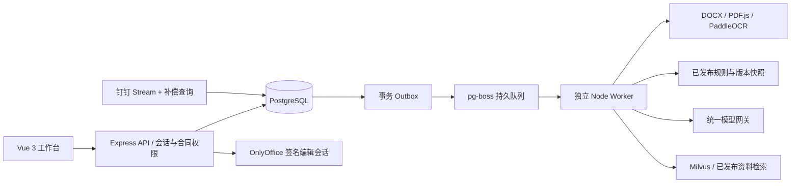

# 法律 Agent 合同预审系统 V1.0 · 实施说明

文档日期：2026-10-29。本文记录本次源码实现、运行方式和验收边界。业务范围以用户确认的 V1.0 计划为基线；测试通过不等于法务质量验收或外部系统联调通过。

## 1. 产品目标与边界

系统面向公司法务，形成“接收 → 解析 → 分类 → 匹配规则 → 检索依据 → AI 预审 → 人工复核 → 修改重审 → 结论 → 人工回传归档”闭环。

AI 技术任务完成与法务最终结论分别保存。AI 无权操作审批同意按钮、直接发布规则或修改本机文件。正式知识由具备发布权限的人员审核发布，反馈只进入候选库。

首期有全部五大类、十四个二级类型目录，包含“其他”兜底类型。专项启用状态按数据库中已发布的二级类型规则动态计算，任一目录类型均可在发布规则后正式预审。内置采购、海外仓、软件类参考检查项可显式进行示例试审，不改变正式规则状态，也不能直接形成最终结论。境外法律仍需专项人工判断。

不包含飞书、电子签章、付款履约、自动批准审批、模型训练或自动生成获法律认可的终稿。

## 2. 二开基线与目录

- 上游：<https://github.com/xiaodingfeng/contract-review>
- 固定提交：`c70e32aaad9525b2b60a099ab0251ae64b2d4044`
- 原 MIT 许可保留在根目录 `LICENSE`，原说明保留为 `README.upstream.md`。
- 活跃后端入口：`backend/index.js`；业务实现：`backend/pilot/`。
- 活跃前端入口：`frontend/src/main.js`；工作台页面：`frontend/src/pilot/`。
- 上游未启用的路由、页面和服务保留以供对照，不挂载旧指纹登录、匿名文件下载或自动公开法律导入流程。
- 报告 DOCX / PDF 继续复用上游报告模块；HTML 报告适配为版本、依据和人工复核报告。

## 3. 架构与运行进程

API 负责权限、版本、人工操作和配置；Worker 执行耗时流程；OCR 使用独立 Python 进程并发 1。Socket.IO 只提供进度提示，数据库记录是事实来源，前端定时查询补偿。

Node 使用 24 LTS；Express / Knex / PostgreSQL / pg-boss；前端 Vue 3、Vite、Element Plus、PDF.js。外部模型使用 OpenAI 兼容聊天与 Embedding 接口。Jev 使用 TypeSafe 托管 API，仅用于离线分类对比。

Milvus 只索引当前任务可用的已发布资料。必检规则始终直接加载，不能依靠向量召回替代。未配置向量检索时，短资料包完整纳入依据；资料过长且无法检索则停止并要求配置，避免静默截断。

## 4. 权限模型

| 角色 | 权限 |
|---|---|
| admin | 全部合同、提交、法务复核、规则编辑与发布、评测、配置、运行及审计 |

所有账号统一保存 `roles=["admin"]`，升级迁移旧账号。部门仅作备注，不限制管理员的合同访问范围；保留多个管理员账号，按实际登录账号记录审计。服务端仍检查有效会话、账号启停和写入权限。

登录使用 scrypt、HttpOnly / SameSite 会话和 PostgreSQL 会话存储。写请求同时检查 CSRF，浏览器 Origin 必须符合 PUBLIC_URL。账号停用和密码重设会失效已有会话。最后一个管理员不能被停用或移除管理权限。

## 5. 核心领域对象

| 数据表 | 业务含义 |
|---|---|
| la_contracts | 合同业务身份、部门、来源、业务背景、当前文件与任务指针、法务状态 |
| la_versions | 不可变文件版本、父版本、SHA-256、文件位置、解析结果；contract / supplement / signed 分开 |
| la_reviews | 单次预审状态、步骤、覆盖结果、错误及依据快照 |
| la_findings | 每条规则的符合/问题/无法判断、原文证据、建议及人工处理 |
| la_decisions | 最终结论，唯一绑定预审及文件版本 |
| la_rule_versions | 通用、一级、二级、标签或模板规则的版本和发布状态 |
| la_feedback | 候选规则、漏报、误报、正常表达和分类纠错 |
| la_evaluation_cases / la_evaluations | 调试/独立验收样本及比较结果 |
| la_integration_events / la_source_files | 接入事件幂等、审批附件到业务版本的关联 |
| la_outbox / la_job_steps | 可靠派发和执行轨迹 |
| la_editor_sessions / la_editor_saves | 编辑会话、已处理内容哈希，防重复回调及旧回调覆盖 |
| la_archives / la_audit | 终稿、签署件、回传记录与审计 |

所有业务扩展使用 `la_` 命名空间，迁移不会删除上游合同表。没有自动 destructive down；升级前备份。见迁移目录及 OpenAPI。

## 6. 文件、解析与定位

PDF / DOCX 限制 50MB，同时检查扩展名与内容标识；旧 DOC 明确要求转换。文件以合同及版本 UUID 写入受控 objects 目录，不覆盖原件。

- DOCX 解析段落、标题样式、自动编号元数据、表格、行和单元格位置。
- DOCX 预审采用当前文本视图，含插入、不含删除；有修订标记时增加必须由人工处理的核查项。
- 文字 PDF 保存页码、坐标及页面尺寸；解析器结合原生文字与绘制操作区分空白页、少文字页和扫描页：少文字原生页直接保留文字，含图像或无法可靠提取正文的页面才调用 OCR，支持文字页和扫描页混合。
- OCR 置信度不足时突出提示，并增加人工核查项；金额、日期、主体仍需核实。
- 块编号在同一版本解析结果中稳定，任务复用保存的解析结果；跨文件版本不假定块编号语义一致。
- 加密、损坏、解析为空或 OCR 不可用进入待处理，不能伪装为完整报告。

DOCX 结构化预览支持原文锚点，在线编辑使用 OnlyOffice。PDF 用 Canvas 展示页面并按原文块坐标高亮。版本差异以结构化文本变化为辅助，原件和历史版本始终可下载核查。

## 7. 任务与模型流程

技术状态：`queued / running / waiting_input / completed / failed / cancelled`。

法务状态：`pending_review / in_review / returned / finalized / archived`。

事务内同时保存 ReviewRun 和 Outbox；派发器使用固定 UUID 创建 pg-boss 任务，发送成功但尚未标记时重启不会重复创建。进程异常使用队列心跳和持久任务恢复；任务执行持有数据库会话锁，避免同一预审同时运行。

每个网络调用最多三次；429 使用 Retry-After；不重试鉴权和配置错误。业务失败已记录时正常结算队列，避免队列重试与网络重试相乘。队列自身重试用于工作进程意外退出。

模型网关只返回结构化分类与检查结果。合同和检索资料作为不可信数据传入，不能授权下载、执行脚本、写数据库或发布知识。前端不持有密钥。

长合同逐块执行所有适用规则，保存全部块的覆盖记录。块内未发现不能直接认定全文缺失；存在明确问题条款的结果优先于局部符合结果。跨条款综合判断的质量需要历史合同验证，不能据固定流程推断已达到召回目标。

每次任务记录文件哈希、分类目录、分类、规则及资料版本、检索方式、背景、提示词版本、解析版本、模型地址和名称。已建立快照的重试保留规则；模型配置变化会要求创建新任务，避免同一快照混用供应商。

已有条款判断必须引用相应块内可验证的精确原文。缺失项不允许原文或页码。规则不能漏检或重复，法律资料 ID 必须来自本任务已检索依据。结构或引用不通过时进入待人工处理。

## 8. 人工复核与最终结论

法务可以采纳、驳回、修正、补充风险、标记补充信息。驳回、修正和处理不确定项需要理由，保存操作人、时间及修正内容。写请求携带记录 revision；冲突返回 409，不能覆盖他人的处理。

确认结论前检查：当前文件与任务、完整覆盖、分类及我方立场已确认、全部风险及无法判断项已处理、合同未退回、此前没有结论。附条件同意必须填条件，不同意必须填理由。

新文件使分类确认和当前结论失效，产生新预审；历史结论和复核不被复制。相同文件按新规则重新审查只增加预审记录。OnlyOffice 或 Word 上传有内容变化形成新文件版本；重复回调按编辑会话和哈希去重。

人工回传后记录操作者和时间，归档关联当前结论及独立签署件。电子归档不等于已经线下盖章。

## 9. 规则、模板与评测

规则草稿以 revision 检测并发，可原地保存；正式版本不可编辑，须复制新草稿。状态为 draft → pending → published → retired。发布同一包新版本保留并停用旧版本，仅影响之后新建的预审任务；排队任务在创建时已固定规则及分类指导快照。草稿记录 base_version_id，其他版本先发布时拒绝过期草稿发布。重复规则 ID 或依据冲突明确阻止任务。

示例提供通用、采购、海外仓、软件四个草稿包。软件专项覆盖开发、许可、订阅和维护服务，共 11 项软件专项检查。模板以 template scope 的条款对照检查项和已确认参考资料表示；本实现不自动做法律认可的全文套版或修改。

`POST /reviews` 支持 `mode=formal|trial`，默认 formal；正式模式只使用已发布版本。trial 在创建任务时把内置示例规则复制到快照，执行时按分类选择通用及对应专项，不加载用户未发布的草稿，也不自动发布任何规则。页面、预审记录与导出报告标明示例模式；最终结论接口以 `TRIAL_REVIEW_ONLY` 阻止试审结论。修改文件、背景和分类产生的新任务保留此前显式选择的模式，点击正式重新预审才切回正式模式。历史未标明模式的任务按 formal 处理。

反馈界面显示待处理、已生成草稿、已发布、已停用。误报、漏报和规则建议通过 POST /feedback-cases/:id/rule-draft 生成并关联草稿；无法定位时必须人工选择规则包。正常表达通过 knowledge-draft 写入参考资料草稿；分类纠错通过 classification-draft 创建可版本化的分类指导。正式发布在事务内关联反馈及审计。反馈保存合同版本、检查项、提交人、draft_rule_version_id、rule_version_id 或 classification_version_id；revision 防覆盖。不会自动训练模型。

la_classification_guidance_versions 保存各类型的分类说明、适用边界、排除条件和示例；仅正式版本进入分类调用。预审创建时固定指导版本，重试和历史结果保留原快照。反馈样本预览自动带入合同正文和法务确认结果，法务核实后保存，按 source_feedback_id 去重。草稿评测仅允许规则调试集，固定草稿内容及 revision，评测不发布规则。

评测支持相同样本集下 llm / jev 分类比较、专项标签漏判、风险精确率、高风险召回、耗时和调用 usage。费用金额需结合实际供应商账单或价格，usage 不直接宣称为已结算成本。

每类至少 20 份历史合同、调试与独立验收分离、法务标准标注是正式验收前提。95% 分类 / 95% 高风险召回 / 80% 精确率只是目标；本次虚构样本与接口测试不证明这些质量指标已达到。缺少高风险正例不能宣告通过。

## 10. 钉钉接入

官方 dingtalk-stream SDK 接收事件，先持久化，再返回 SUCCESS。SDK 同步事件回调不足以等待数据库，本实现覆盖其 onEvent 处理并使用 SDK 的 send 应答。此兼容点必须纳入升级回归测试。

审批详情、实例 ID 查询和附件下载接口已按发布的 `@alicloud/dingtalk@2.2.48` workflow SDK 核对。配置审批 processCode、法务 activityId 或可靠节点名称、业务字段、附件角色与接入归属用户。真实租户权限和字段格式仍需联调确认。

同一事件不重复建任务；同一审批字段与文件名的附件按哈希建立新版本，fileId 更新不另建业务合同。重名附件或多个主合同的补充关系不明确时进入待确认；不会将多个附件拼接。单一主合同的补充附件以 supplement 文件保存且不触发独立预审。

每五分钟按持久游标补偿查询，断网区间按日分页，全部完成后推进游标。默认首轮回看一天。法务节点不能可靠识别时保留待确认记录。接入不能代替审批同意/拒绝操作。

## 11. 运维与交付状态

本机默认仅环回地址；正式入口需 HTTPS。Compose 包含 API、Worker、OCR、PostgreSQL、OnlyOffice、Milvus、etcd 和 MinIO。本机没有 Docker，镜像启动及组件联调不得视为已通过。

备份使用 pg_dump 自定义格式，复制不可变 objects 并生成 SHA-256 清单；默认每日、保留 30 天成功备份。恢复只允许独立空数据库和空目录，校验所有文件并使恢复的会话失效。TOKEN_SECRET 和 .env 需另外安全保管，不能只恢复数据库后丢失加密配置的解密能力。

原生开发环境使用 Windows PostgreSQL；已执行数据库备份和隔离恢复测试。开发用二进制缓存和凭据位于忽略目录，不进入源码。生产应采用公司维护的数据库和镜像版本。

交付检查清单、尚未联调项、接口、操作和部署步骤分别见 `需求追踪与验收.md`、`openapi.json`、`部署与操作手册.md`。公司样本、法务正式规则、模型和钉钉凭据仍需对应负责人提供。
