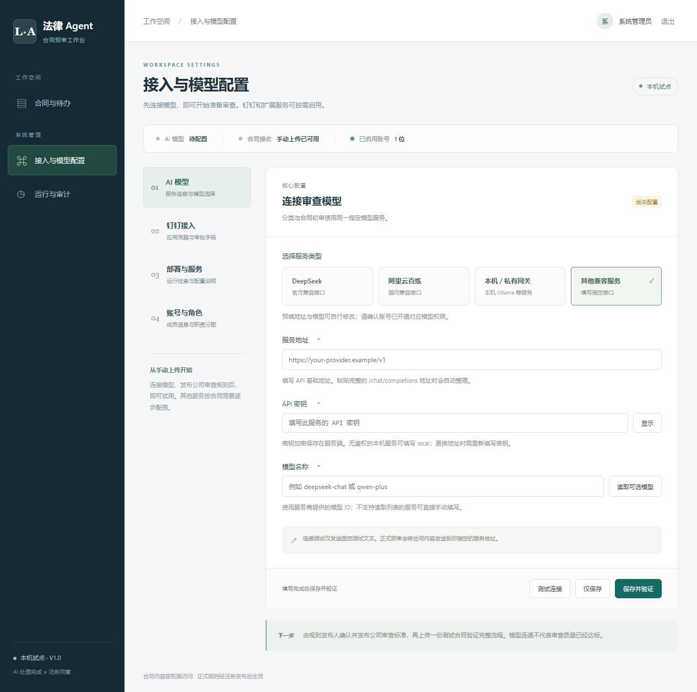
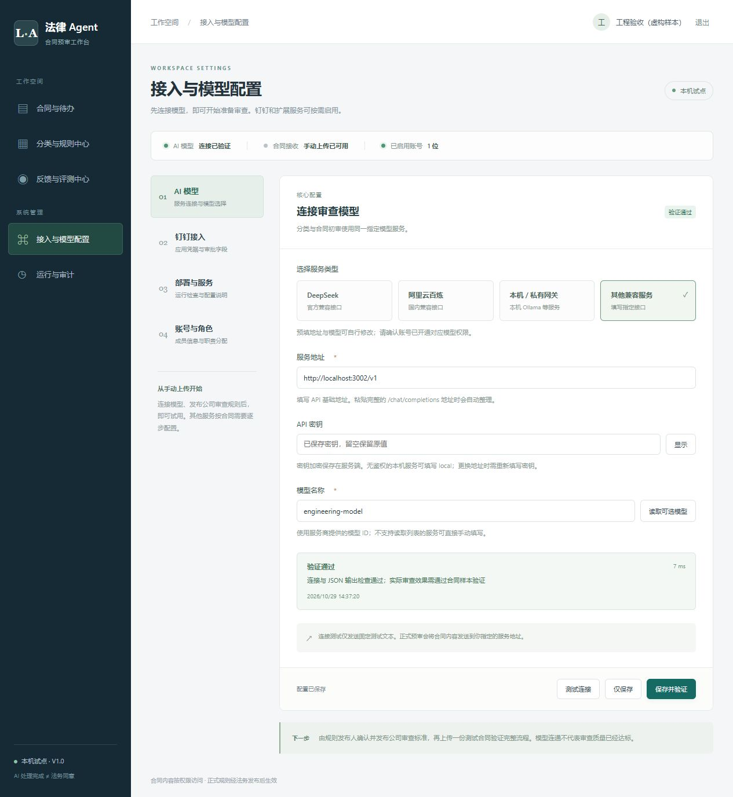

# 配置模块使用说明

入口：<http://localhost:8080/#/settings>。使用系统管理员账号。

## AI 模型

1. 选择 DeepSeek、阿里云百炼、本机服务或其他兼容服务，地址和模型可继续修改。
2. 填写服务的 API 基础地址、密钥和模型 ID。粘贴 `/chat/completions` 完整地址会自动整理为基础地址。
3. 可读取服务返回的模型列表，也可手动填写。并非所有兼容服务都提供模型列表接口。
4. 点击“测试连接”验证当前表单；点击“保存并验证”将配置保存后再验证；“仅保存”不会调用模型。

连接测试仅发送固定短文本，检查聊天接口与 JSON 输出，不发送合同。失败时分别提示密钥、访问权限、接口/模型不存在、限流、网络超时等问题。服务商可能收取少量测试调用费用。

已保存的密钥不回显，留空保留；更换地址必须填写新服务的密钥，避免旧密钥发送到其他服务。无鉴权本机服务可填写 `local`。未保存表单测试成功不会认证另一份已保存配置，模型或凭据变化后旧验证结果失效。

模型配置供新预审使用，已有历史任务仍保留其配置快照。已保存且有快照的旧任务不得因更换服务而静默改用新模型；按工作台流程创建新预审。

## 钉钉接入

目标：审批分配给本人 → 自动下载审批表里的 PDF、DOCX。每份文件分别建立合同记录；其他格式跳过。无需填写审批模板编号、法务节点名称、节点 ID 或附件字段名。

1. 钉钉管理员配置企业内部应用的审批读取、附件下载、账号信息读取和 Stream 审批任务事件订阅，并设置网页登录回调地址。具体步骤见 [钉钉自动收件配置](钉钉自动收件配置.md)。
2. 工作台管理员在“应用连接”保存 Client ID / AppKey、Client Secret / AppSecret，并启用自动接入。验证按钮只检查应用鉴权，不证明审批或附件权限已开通。
3. 接收人登录自己的工作台，打开左侧“钉钉收件”，点击“绑定钉钉账号”，使用实际收取审批的账号完成钉钉授权。
4. 新审批分配到此账号时，系统核实当前办理人并下载附件。在“合同与待办”查看文件；缺少业务背景时，补充后继续预审。

接收人使用自己的系统管理员账号，无需钉钉审批管理员身份。多个接收人分别绑定；管理员可查看全部合同，绑定身份仍决定自动收取哪些钉钉待办。

解绑、停用用户或暂停接入后，停止后续收取；已经保存的文件按既有权限保留。内容相同的附件不会重复建立版本，同一字段下同名文件内容改变时保存新版本；同一字段出现多个同名文件时按附件 ID 分开，避免误合并。文件改名会建立独立记录。

Worker 约 15 秒内应用连接配置；已收到事件的审批每 5 分钟复查一次，范围为最近 30 天的原始事件。此机制不能发现从未收到过事件的历史审批，不能保证收取在两次检查之间已转交完成的任务。接入失败可在“运行与审计”查看收取结果并重试，成功文件不会因其他附件失败而回滚。

钉钉凭据加密保存，页面配置优先于环境变量；授权码及用户 accessToken 不落库。应用变更后需要在新应用下重新绑定。旧版本的字段映射不再参与新采集；旧合同保留，新绑定方式首次收取同一审批可能建立独立记录。

## 部署与服务

“检查服务状态”实际检查数据库、Worker 心跳、文件目录，以及已配置的 OCR、OnlyOffice、Milvus。结果区分“检查通过、尚未配置、需进一步确认、验证失败”。OCR 健康响应不代表识别模型已验收，编辑器健康响应也不代表保存回调已验收。

各服务卡片给出用途和 `.env` 配置项。OCR、编辑器、Milvus、Jev、存储路径及任务并发由部署人员管理；修改相应环境变量后重启 API / Worker。此轮没有通过页面自动安装 Docker 或服务。

## 管理员账号

支持按姓名、账号或部门搜索；通过独立弹窗创建和编辑，避免在表格里误改后被其他保存覆盖。所有账号均为系统管理员，无角色多选；部门仅作备注。可设置新账号的启用状态。停用账号会使已有登录失效，最后一个管理员不能被停用。建议一人一账号，以保留审计身份。

## 保存与验证边界

模型与应用连接独立保存；切换配置分类保留未保存输入，提供撤销。离开页面或关闭浏览器时提示未保存更改。配置保存携带更新时间，冲突返回重新载入提示，避免覆盖另一位管理员的新配置。

钉钉新增测试覆盖授权状态过期与重放、跨用户绑定、企业账号唯一性、解绑过程竞争、当前办理人校验、多附件部分失败、去重与版本、账号停用及权限撤销。工程夹具和模拟响应不能证明企业真实钉钉已经联调。

实际配置界面：

仅用于工程交互验证的本机测试服务：

