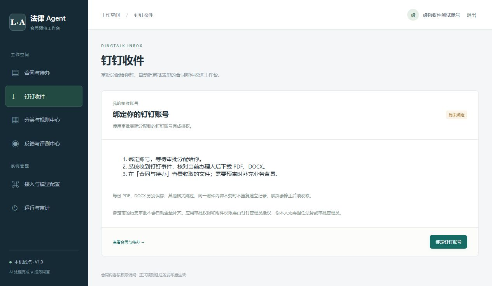

# 钉钉自动收件配置

实现目标：审批当前分配给绑定的钉钉账号时，下载该审批表内的 PDF、DOCX，每份文件分别保存到接收人的工作台。系统不操作审批通过或拒绝，也不自动回传法务意见。

## 管理员配置一次

1. 打开钉钉开发者后台，进入所在企业的内部应用。工作台的 Client ID / AppKey 和 Client Secret / AppSecret 必须来自这个应用。
2. 在应用的权限管理中，为以下接口开通对应权限。权限页面可能按接口名称展示，搜索下列接口更容易核对：

   | 用途 | 程序使用的接口 |
   | --- | --- |
   | 读取审批实例及当前任务 | `GET /v1.0/workflow/processInstances` |
   | 为审批附件取得下载地址 | `POST /v1.0/workflow/processInstances/spaces/files/urls/download`（涉及 `Workflow.Instance.Write`，以后台接口要求为准） |
   | 读取本人授权身份 | `GET /v1.0/contact/users/me`（个人信息读取权限） |
   | 在应用所属企业中取得 UserID | `POST /topapi/user/getbyunionid`（通过 UnionID 获取用户 UserID） |

   账号映射需要应用令牌，个人身份需要用户授权令牌。程序不会仅凭用户手填 UserID 或事件中的 staffId 建立绑定。

3. 检查应用可使用范围、通讯录访问范围及审批数据授权范围，包含接收账号和目标审批。仅有本人能打开审批，不等于应用能通过接口下载附件。
4. 在应用“事件与回调 / 事件订阅”配置 Stream 模式，订阅审批任务变更事件 `bpms_task_change`，按后台要求发布生效。Worker 使用应用凭据连接 Stream，不需要公网事件回调服务器。
5. 在应用的网页登录配置中，填写授权回调地址。工作台“钉钉接入”页面会显示完整地址，格式为 `PUBLIC_URL/dingtalk/callback`。`PUBLIC_URL` 是浏览器实际访问的工作台地址；正式部署使用可访问的 HTTPS 地址，并按钉钉要求配置登录域名和回调地址。网页登录回调和 Stream 是两项独立配置。
6. 工作台管理员打开“接入与模型配置 → 钉钉接入”，保存应用标识和密钥，点击“验证应用凭据”，启用自动接入并保存。Worker 约 15 秒内应用配置。

“凭据验证通过”只代表可以取得应用令牌。还需要下一节的真实审批测试，才能确认所需权限和数据格式均可用。

## 接收人操作一次

1. 用自己的系统管理员账号登录，左侧打开“钉钉收件”，无需额外分配角色。
2. 点击“绑定钉钉账号”，在钉钉登录页使用实际接收审批的账号完成授权。
3. 返回工作台，确认显示本人姓名及“已绑定”。授权请求 10 分钟内有效，过期后重新点击绑定。

接收人不需要担任法务或 OA 审批管理员。应用授权需要钉钉管理员完成。绑定在本人工作台账号下，同一个应用内的同一钉钉账号不能同时绑定另一个工作台账号。

## 验证一张审批

1. 新建一张测试审批，附件包含一份无敏感信息的 PDF 或 DOCX，并让审批流转到已绑定账号。
2. 等待任务事件送达，打开“合同与待办”，查看来源为“钉钉审批”的文件。
3. 多份 PDF、DOCX 分别建立记录，Excel、图片等其他格式跳过；每份文件上限 50 MB。自动读取表单附件和明细表中的结构化附件，当前不采集评论区附件或外部链接文件。
4. 附件保存后，缺少我方主体、交易立场或目的会提示补充业务背景。点击补充并保存后继续预审，这不影响文件已经收取。
5. 工作台管理员可在“运行与审计 → 钉钉接入”查看新增、重复、跳过、失败数量。一份文件失败不会阻止其他文件保存，修复权限或文件问题后可重试。

## 边界与排查

- 无文件：先检查审批当前办理人是否为绑定账号，再检查 Stream 事件、应用审批数据范围及附件权限。已结束、转交或完成的任务不会作为当前待办采集。
- 绑定失败：检查网页登录回调地址、个人信息权限、UnionID 查询权限，以及账号是否属于应用所属企业且在可访问范围内。不要在聊天中发送应用密钥或授权码。
- 已收到事件的审批每 5 分钟复查一次，覆盖最近 30 天原始事件。没有收到过事件的历史审批不会自动全量补齐，快速流转离开的任务也可能不再满足“当前分配给本人”的条件。
- 同一字段同名文件以内容哈希去重；内容改变保存新版本。同一字段有多个同名附件时按文件 ID 分开保存；重命名文件会建立独立记录。
- 解除绑定、停用工作台账号或关闭接入，将阻止后续写入，已经收取的合同继续保留，管理员可查看。
- 更新程序后先运行 `npm run db:migrate`，再重启 API 与 Worker。旧字段映射不再参与新采集，旧合同不会被删除或自动合并。

本地测试使用工程夹具验证逻辑；真实企业应用的网页登录、权限授权、Stream 推送和附件下载仍需按本页完成联调。

## 页面验证

在独立测试数据库中验证了未配置提示、免映射保存连接、授权回调失效处理和地址清理；未连接真实钉钉。

